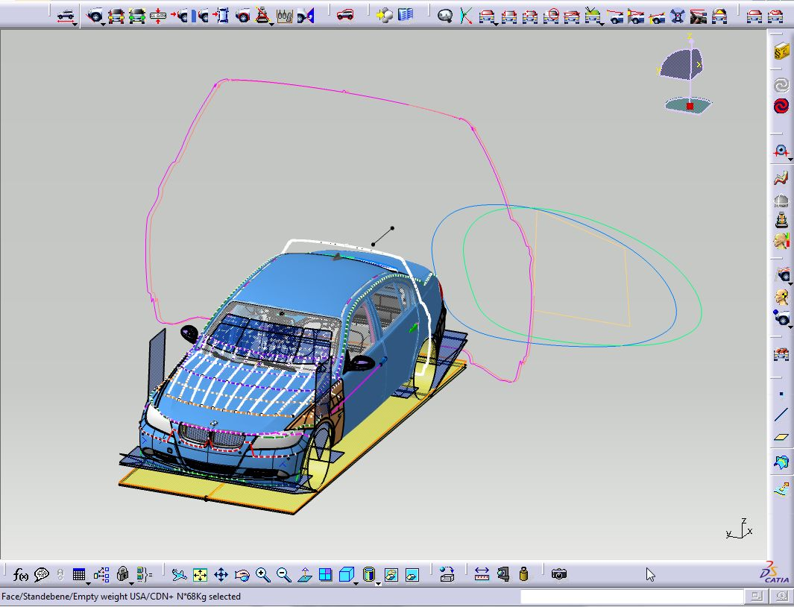
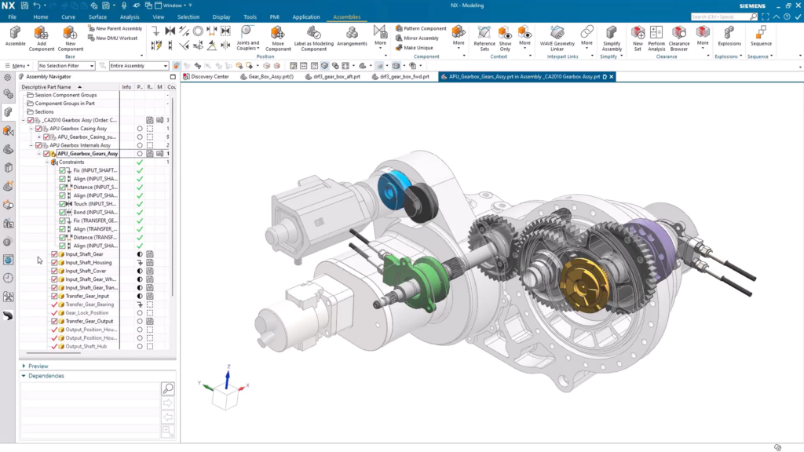
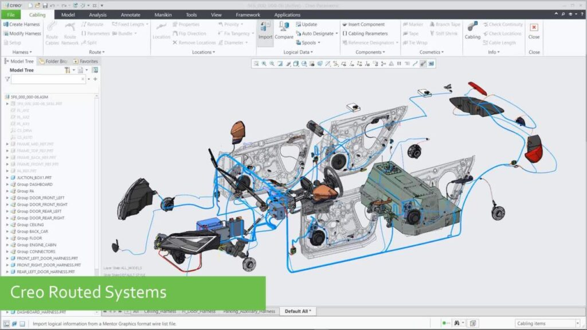
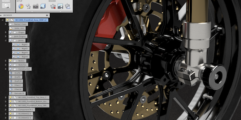
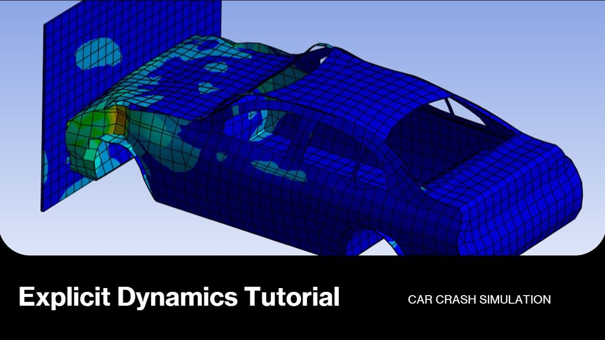
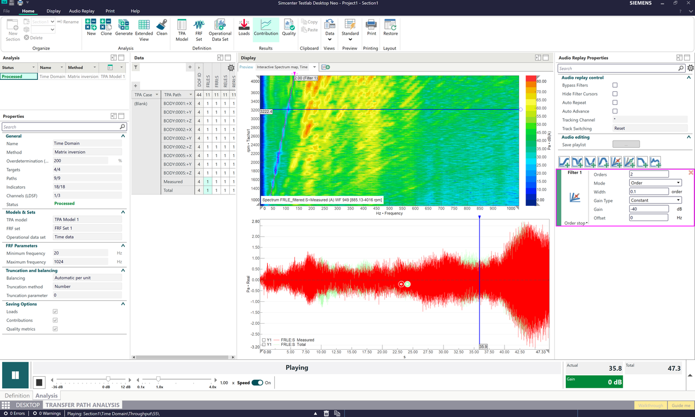

# Content
Topic: **Automotive Engineering**

## Overview/Introduction/Context
* Automotive engineering combines mechanical engineering, electrical engineering, software development, manufacturing, and design to create safer, more efficient, and more advanced vehicles.
* Modern vehicles rely heavily on software for design, simulation, testing, manufacturing, diagnostics, automation, and electric vehicle systems.
* Automotive engineers use specialized software throughout the vehicle development process, from creating 3D models to testing crash safety and managing manufacturing operations.
* As vehicles continue to become more technologically advanced, software plays an increasingly important role in improving performance, safety, sustainability, and production efficiency.

## Part A: existing technology

##### Software
---

### Searches Used

* "automotive engineering software"
* "automotive engineering programs"
* "automotive design software"
* "automotive CAD software"
* "automotive simulation software"
* "automotive manufacturing software"
* "vehicle design software"
* "automotive engineering applications"
* "software used by automotive engineers"
* "automotive product lifecycle management software"
* "automotive CAE software"
* "vehicle dynamics software"
* "automotive factory software"
* "electric vehicle engineering software"
* "automotive industry engineering software"

---

* **CATIA**
  * Link: https://www.3ds.com/products/catia
  * Used by many automotive manufacturers for vehicle and component design.
  * Creates advanced 3D models and vehicle surfaces.
  * Commonly used for designing car bodies and automotive parts.
  * Hardware: Windows Workstations.
  * Picture:
    
  * Image URL: https://www.3ds.com/fileadmin/depositary/alliances/CRM_PARTATT/20141200/PPR0000189_1cava_1251_screen.jpg
  * Source researched: CATIA is widely used for full vehicle product development and automotive CAD workflows.

* **Siemens NX**
  * Link: https://plm.sw.siemens.com/en-US/nx/
  * Used for vehicle design, engineering, manufacturing, and simulation.
  * Helps engineers design complete vehicle assemblies.
  * Supports CAD and CAM workflows.
  * Hardware: Windows Workstations.
  * Picture:
        
  * Image URL: https://blogs.sw.siemens.com/wp-content/uploads/sites/2/2025/02/Screenshot-2025-02-24-124701-1-1024x576.png
  * Source researched: Siemens NX supports complex assemblies and automotive manufacturing workflows.

* **PTC Creo**
  * Link: https://www.ptc.com/en/products/creo
  * Parametric CAD software.
  * Allows engineers to create and modify vehicle parts efficiently.
  * Often used for product development and manufacturing preparation.
  * Hardware: Windows.
  * Picture:
        
  * Image URL: https://skillableindia.com/wp-content/uploads/2023/07/image-1024x576.jpg
  * Source researched: Creo is a major automotive engineering CAD platform.

* **Autodesk Fusion 360**
  * Link: https://www.autodesk.com/products/fusion-360
  * Cloud-based CAD software.
  * Used for designing automotive components and prototypes.
  * Supports generative design for lightweight vehicle parts.
  * Hardware: Windows, macOS, Web Browser.
  * Picture:
        
  * Image URL: https://develop3d.com/wp-content/uploads/2019/11/fusion_intro.png
  * Source researched: Fusion 360 is used for automotive drafting and design workflows.

* **Onshape**
  * Link: https://www.onshape.com
  * Browser-based CAD platform.
  * Allows engineers to collaborate on vehicle designs in real time.
  * Useful for team-based engineering projects.
  * Hardware: ChromeOS, Windows, macOS, Linux, Web Browser.
  * Picture:
        .jpeg)
  * Image URL: https://encrypted-tbn0.gstatic.com/images?q=tbn:ANd9GcSGBaZYOIiff5OcMYIAFM0HxeRz0C6FsaFrU0-Ortqx270Av-UDUtiYeFw&s=10
  * Source researched: Onshape is known for cloud collaboration and automotive CAD design.

* **ANSYS**
  * Link: https://www.ansys.com
  * Engineering simulation software.
  * Tests crash performance, airflow, heat transfer, and vehicle safety.
  * Helps reduce the need for physical prototypes.
  * Hardware: Windows, Linux, High-Performance Computing Systems (HPC).
  * Picture:
        
  * Image URL: https://i.ytimg.com/vi/EhTO0_ovhnA/maxresdefault.jpg
  * Source researched: ANSYS is used for crash, aerodynamic, thermal, and performance simulations.

* **Siemens Simcenter**
  * Link: https://plm.sw.siemens.com/en-US/simcenter/
  * Vehicle simulation software.
  * Analyzes durability, battery performance, aerodynamics, and noise.
  * Helps improve vehicle performance before physical testing.
  * Hardware: Windows, Engineering Workstations, HPC Systems.
  * Picture:
      
  * Image URL: https://blogs.sw.siemens.com/wp-content/uploads/sites/6/2026/09/Simcenter-Testlab-Transfer-path-analysis-1-1280x768.png
  * Source researched: Simcenter supports durability, CFD, NVH, and electrification analysis.

---

### Key Findings

* Automotive engineering relies heavily on **CAD software** for vehicle design.
* Engineers use **simulation software** to test safety, aerodynamics, durability, and performance before building real prototypes.
* Software allows engineers to model, analyze, and improve vehicles before they are manufactured.
* Many automotive software tools support electric vehicle development, battery systems, and future transportation technologies.
* Modern automotive development depends on software throughout the design, testing, and production process.

---
##### Hardware
---

### Searches Used

* "automotive engineering hardware"
* "hardware used by automotive engineers"
* "automotive manufacturing robots"
* "electric vehicle battery technology"
* "vehicle testing equipment"
* "automotive engineering tools"
* "LiDAR sensors automotive"
* "automotive radar systems"
* "automotive safety testing equipment"
* "automotive factory technology"
* "automotive engineering devices"
* "EV battery testing systems"
* "wind tunnel automotive testing"
* "automotive diagnostic hardware"
* "robotics in automotive engineering"

---

* **Industrial Robotic Arms**
  * Link: https://www.fanucamerica.com
  * Used in vehicle manufacturing to weld, paint, assemble, and move vehicle parts.
  * Improves production speed, accuracy, consistency, and worker safety.
  * Commonly used by companies such as Tesla, Ford, Toyota, and BMW.
  * Availability: Available for purchase directly from industrial robotics manufacturers such as FANUC and other automation suppliers. Typically purchased by factories and manufacturing facilities rather than individual consumers.
  * Picture:
    IMAGE_URL_HERE
  * Image URL: IMAGE_URL_HERE
  * Source researched: Industrial robots are a major part of modern automotive manufacturing and assembly lines.

* **LiDAR Sensors**
  * Link: https://velodynelidar.com
  * Uses laser beams to create a detailed 3D map of a vehicle's surroundings.
  * Helps autonomous and semi-autonomous vehicles detect roads, objects, and pedestrians.
  * Important for self-driving technology and advanced safety systems.
  * Availability: Available through LiDAR manufacturers and automotive suppliers for research, testing, and autonomous vehicle development.
  * Picture:
    IMAGE_URL_HERE
  * Image URL: IMAGE_URL_HERE
  * Source researched: LiDAR is widely used in autonomous vehicle testing and development.

* **Automotive Radar Sensors**
  * Link: https://www.bosch.com
  * Detects nearby vehicles, obstacles, and objects.
  * Used in adaptive cruise control, collision avoidance, and blind-spot monitoring.
  * Performs well in poor weather conditions such as rain and fog.
  * Availability: Commonly available through automotive manufacturers and suppliers and installed in many modern vehicles.
  * Picture:
    IMAGE_URL_HERE
  * Image URL: IMAGE_URL_HERE
  * Source researched: Radar sensors are essential hardware for modern vehicle safety systems.

* **Electric Vehicle Battery Packs**
  * Link: https://www.tesla.com
  * Stores electrical energy used to power electric vehicles.
  * One of the most important hardware components in EV engineering.
  * Engineers focus on improving battery range, charging speed, performance, and safety.
  * Availability: Available through electric vehicle manufacturers and battery suppliers. Primarily designed for vehicle production and engineering applications.
  * Picture:
    IMAGE_URL_HERE
  * Image URL: IMAGE_URL_HERE
  * Source researched: Battery technology plays a critical role in electric vehicle development.

* **Battery Testing Systems**
  * Link: https://www.keysight.com
  * Used to test battery durability, charging cycles, efficiency, and safety.
  * Helps engineers improve battery performance before vehicles are released.
  * Frequently used in EV research and development laboratories.
  * Availability: Available through engineering equipment companies and laboratory testing suppliers for professional and industrial use.
  * Picture:
    IMAGE_URL_HERE
  * Image URL: IMAGE_URL_HERE
  * Source researched: Battery testing hardware helps ensure electric vehicle batteries meet safety and performance standards.

* **Vehicle Dynamometers**
  * Link: https://www.horiba.com
  * Testing equipment that measures vehicle and engine performance.
  * Simulates real driving conditions while keeping the vehicle stationary.
  * Used to evaluate horsepower, torque, fuel efficiency, and emissions.
  * Availability: Available from automotive testing equipment manufacturers and primarily used by engineering companies, manufacturers, and research facilities.
  * Picture:
    IMAGE_URL_HERE
  * Image URL: IMAGE_URL_HERE
  * Source researched: Dynamometers are commonly used during automotive testing and development.

* **Wind Tunnels**
  * Link: https://www.nasa.gov
  * Used to study vehicle aerodynamics.
  * Allows engineers to observe airflow around a vehicle.
  * Helps improve efficiency, stability, and fuel economy while reducing drag.
  * Availability: Typically built and operated by automotive companies, research organizations, universities, and testing centers rather than sold as consumer products.
  * Picture:
    IMAGE_URL_HERE
  * Image URL: IMAGE_URL_HERE
  * Source researched: Wind tunnels are important tools for aerodynamic vehicle design and testing.

* **Vehicle Diagnostic Scanners**
  * Link: https://www.snapon.com
  * Connects to a vehicle's onboard computer system.
  * Reads fault codes and identifies mechanical or electrical problems.
  * Used by engineers and technicians for troubleshooting and performance analysis.
  * Availability: Widely available through automotive tool companies and online retailers for both professional technicians and advanced vehicle diagnostics.
  * Picture:
    IMAGE_URL_HERE
  * Image URL: IMAGE_URL_HERE
  * Source researched: Diagnostic scanners help identify and analyze vehicle system issues.

---

### Key Findings

* Automotive engineering relies on a combination of manufacturing, testing, safety, and diagnostic hardware.
* Robotics and automation technologies are essential for modern vehicle production because they improve efficiency, precision, safety, and manufacturing consistency.
* Sensors such as LiDAR and radar help improve vehicle safety and support autonomous and driver-assistance technologies.
* Battery technology has become increasingly important because of the rapid growth of electric vehicles and sustainable transportation.
* Testing equipment such as dynamometers, battery testing systems, and wind tunnels allows engineers to improve vehicle performance, efficiency, reliability, and safety before production.
* Modern automotive engineering combines mechanical systems, electronics, sensors, robotics, and advanced testing equipment to develop next-generation vehicles.
* Hardware and software work together throughout the entire automotive engineering process, from vehicle design and testing to manufacturing and real-world operation.

---

## Part B: possible future technology
* Idea
  * Detail
